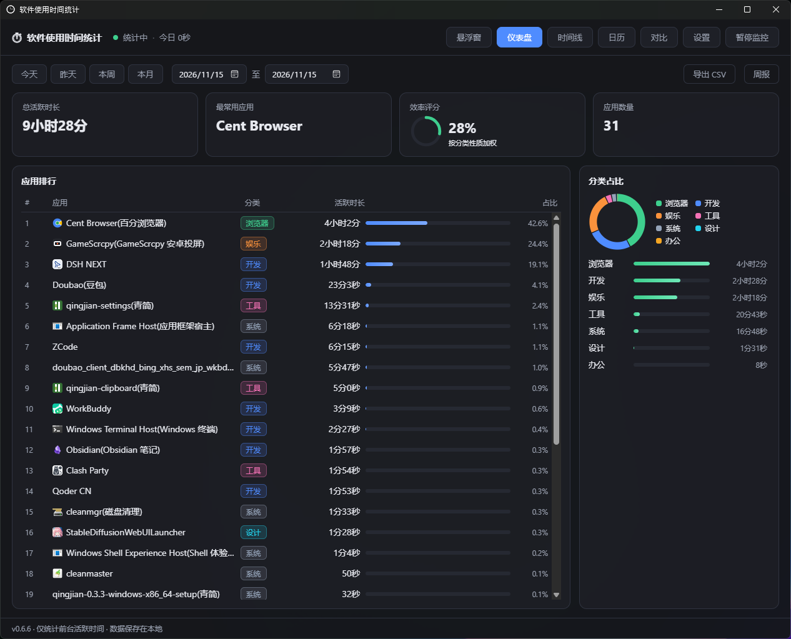
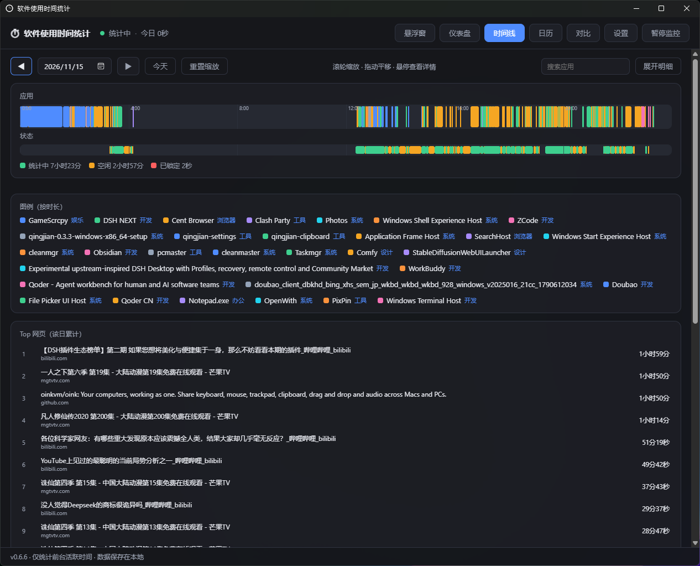
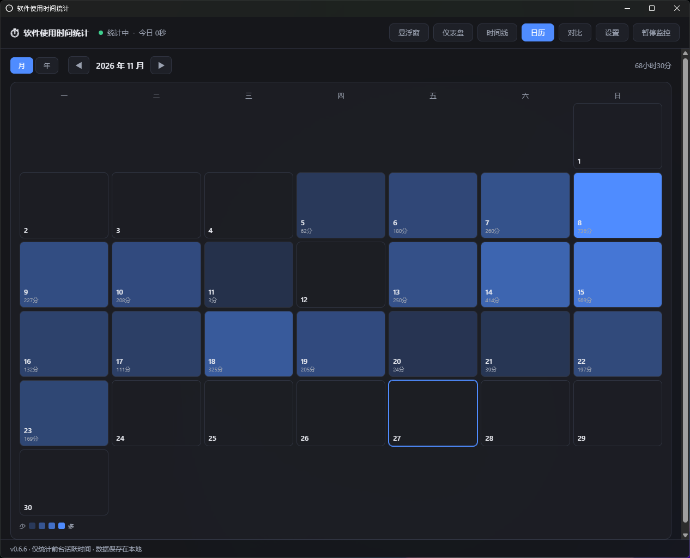
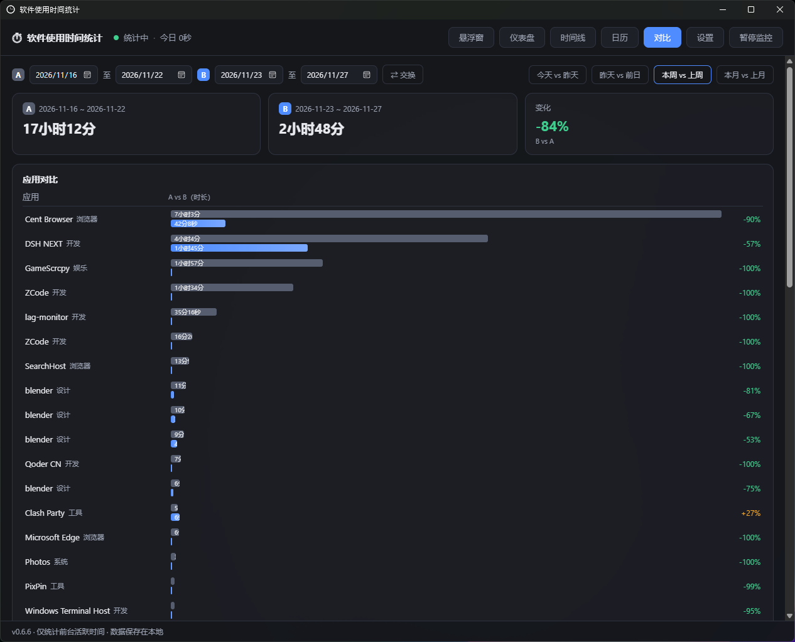
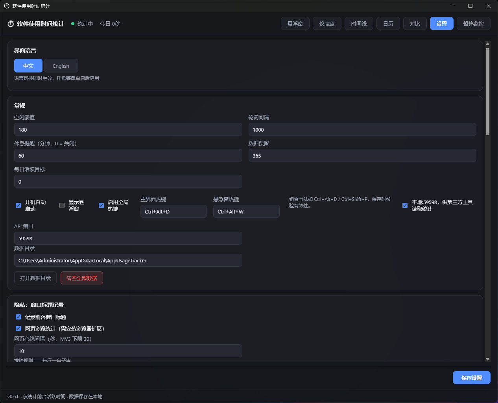
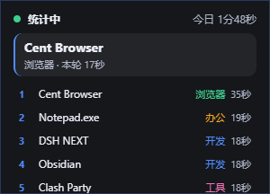

# AppUsageTracker

[](LICENSE) [](https://v2.tauri.app/) [](https://svelte.dev/) [](#兼容性)

Windows 桌面端的软件使用时间统计工具。按前台激活时长记录应用与分类的使用情况，提供仪表盘、时间线、日历热力图、对比视图与周报导出。核心统计在 `crates/tracker-core`（Rust），桌面壳为 Tauri 2，界面为 Svelte 5，数据只落在本机 SQLite 文件，不依赖账号或云端。

当前版本 `v0.7.0`（2026-11-28）。它不是员工监控、上网行为审计或键盘记录工具，也没有 macOS / Linux 发布包。

[功能](#功能) · [截图](#截图) · [安装](#安装) · [快速开始](#快速开始) · [配置](#配置) · [浏览器扩展](#浏览器扩展可选) · [本地 HTTP API](#本地-http-api) · [数据存储与维护](#数据存储与维护) · [兼容性](#兼容性) · [隐私说明](#隐私说明) · [自动更新](#自动更新) · [项目结构](#项目结构) · [贡献与许可](#贡献与许可) · [已知限制](#已知限制)

## 功能

### 统计

- **前台活跃时间**：只统计获得前台焦点且有键鼠操作的应用时长；无操作超过阈值（默认 180 秒，可配置）自动暂停，区间截止到最后一次输入时刻。
- **锁屏与睡眠感知**：检测到安全桌面或系统睡眠时停止计时，睡眠时长不计入。
- **跨午夜切分**：跨自然日的区间按天切分；程序自身与资源管理器默认不统计，排除列表可调整。
- **分类统计**：内置「开发 / 浏览器 / 办公 / 沟通 / 设计 / 娱乐 / 工具 / 系统」八类关键词规则，支持 `分类=关键词1|关键词2` 自定义，也可在排行中手动指定分类（对历史数据同样生效）。
- **分类限额**：为分类设置每日分钟限额，首次越限弹出系统通知。
- **落库与崩溃安全**：内存增量聚合，每 30 秒、状态切换与退出时写入 SQLite（WAL 模式），异常退出最多丢 30 秒。

### 界面

- **桌面悬浮窗**：Win11 Mica 磨砂置顶小窗，实时显示统计状态、今日活跃、当前应用（含本轮秒表）与 Top5 排行。可整窗拖动，拖出屏幕自动钳回，不抢焦点；支持置顶、锁定、贴边收起、紧凑模式与透明度调节。
- **仪表盘**：今天 / 昨天 / 本周 / 本月 / 自定义区间，含汇总卡、应用排行、分类占比与每日趋势；今日数据随秒级 tick 刷新。
- **时间线**：24 小时色带，支持滚轮缩放、拖拽平移、明细表与搜索，标注统计中 / 空闲 / 锁定 / 挂起状态区间。
- **日历热力图与对比**：贡献图风格的月 / 年热力图；双时段应用与分类并排对比，默认「今天 vs 昨天」，另有「昨天 vs 前日 / 本周 vs 上周 / 本月 vs 上月」快捷区间。
- **托盘**：左键打开主界面；右键菜单含悬浮窗开关、暂停监控、设置与退出。关闭主窗口只隐藏到托盘。
- **导出**：CSV（UTF-8 BOM，兼容 Excel，导出后打开所在目录）、JSON 全量备份与恢复、Markdown 周报。
- **其他**：开机自启（HKCU Run）、单实例、全局热键、休息提醒、中英双语。

### 可选记录

- **窗口标题**：默认关闭，开启后时间线出现「Top 标题」，可用子串排除规则过滤。
- **网页浏览**：默认关闭，开启并安装扩展后按域名与标题聚合时长，时间线出现「Top 网页」。

### 本地集成

- **HTTP API**：默认开启，仅监听 `127.0.0.1:59598`，供第三方工具读取统计。

## 截图

截图取自 v0.6.6 运行中的真实窗口，通过窗口句柄直接抓取，非效果图。主窗口各页取 2026-11-15，这是历史上应用、标题与网页条目最完整的一天；悬浮窗与对比视图为实时状态。v0.7.0 未重拍截图，界面结构与外观与这组图一致，仅词条与组件组织有变化。










## 安装

1. 打开 [GitHub Releases](https://github.com/StarAsh042/AppUsageTracker/releases)，在 `v0.7.0` 中下载 `AppUsageTracker_0.7.0_x64-setup.exe`（NSIS 安装包）。
2. 运行安装向导，完成后从开始菜单启动。

环境要求为 Windows 10 / 11 x86_64 与 WebView2 Runtime（Windows 11 及装有 Edge 的 Windows 10 通常已具备）。

卸载在「设置 → 应用 → 已安装的应用」中完成。卸载不会删除 `%LocalAppData%\AppUsageTracker\` 下的统计数据，需要清理请手动删除该目录。

验证安装，启动后本地 API 应可访问：

```bash
curl -s http://127.0.0.1:59598/api/version
```

预期返回包含 `0.7.0` 的 JSON。安装包未做 Windows Authenticode 签名，发布流水线只生成 Tauri 更新器使用的 `.sig` 签名，首次运行可能触发 SmartScreen 提示（【推测】，未在真机验证）。

## 快速开始

从源码运行需要 Rust stable 的 `stable-x86_64-pc-windows-msvc` 工具链、勾选「使用 C++ 的桌面开发」的 Visual Studio Build Tools，以及 Node.js >= 20（CI 用 22）与 npm。仓库使用 `package-lock.json`，不使用 pnpm / yarn。以下命令均以仓库根目录为当前目录。

```bash
npm ci
npm run tauri dev
```

`beforeDevCommand` 先启动 Vite（`http://localhost:5173`），随后 Tauri 打开窗口。终端按 `Ctrl+C` 停止。首次构建需下载并编译 Rust 依赖，可能超过 10 分钟。

其他常用命令，与 `.github/workflows/ci.yml` 一致：

```bash
npm run check                               # svelte-check 类型检查
npm run lint                                # eslint 静态检查
npm run format:check                        # prettier 格式检查
npm test                                    # vitest：33 个纯逻辑用例 + 14 个组件用例
npm run build                               # 仅构建前端产物到 dist/
cargo test -p tracker-core                  # 聚合状态机单元测试
cargo fmt --all --check                     # 与 CI 一致的格式检查
cargo clippy --all-targets -- -D warnings   # 与 CI 一致的 lint
npm run tauri build                         # 生产构建（NSIS 安装包 + 独立 exe）
```

构建产物为 `target/release/app-usage-tracker.exe` 与 `target/release/bundle/nsis/*_0.7.0_x64-setup.exe`。

## 配置

配置只在图形界面「设置」中修改，持久化到数据目录下的 `settings.json`，即时生效。本项目没有命令行参数与环境变量覆盖，优先级为「设置页修改 → `settings.json` → 内置默认值」。托盘语言、开机自启等少数项需要重启后完全生效。

键名为 `settings.json` 中的 snake_case 字段，默认值来自 `crates/tracker-core/src/settings.rs` 的 `TrackerSettings::default()`。

| 键                              | 默认值                           | 说明                                               | 敏感 |
| ------------------------------- | -------------------------------- | -------------------------------------------------- | ---- |
| `idle_threshold_seconds`        | `180`                            | 空闲判定阈值（秒），超过即暂停计时                 | 否   |
| `foreground_poll_ms`            | `1000`                           | 前台窗口轮询间隔（毫秒）                           | 否   |
| `start_with_windows`            | `false`                          | 开机自启（写入 HKCU Run）                          | 否   |
| `excluded_app_keys`             | `["c:\\windows\\explorer.exe"]`  | 不统计的应用列表                                   | 否   |
| `data_directory`                | `%LocalAppData%\AppUsageTracker` | 数据目录，更改后迁移历史数据                       | 否   |
| `theme`                         | `auto`                           | 界面主题                                           | 否   |
| `rest_reminder_minutes`         | `60`                             | 休息提醒间隔（分钟，`0` 关闭）                     | 否   |
| `retention_days`                | `365`                            | 统计数据保留天数                                   | 否   |
| `show_floating_widget`          | `true`                           | 是否显示桌面悬浮窗                                 | 否   |
| `daily_goal_minutes`            | `0`                              | 每日活跃目标（分钟，`0` 关闭）                     | 否   |
| `hotkeys_enabled`               | `true`                           | 是否启用全局热键                                   | 否   |
| `hotkey_main` / `hotkey_widget` | `Ctrl+Alt+D` / `Ctrl+Alt+W`      | 主界面 / 悬浮窗热键，保存时校验冲突                | 否   |
| `api_enabled`                   | `true`                           | 本地 HTTP API 开关                                 | 否   |
| `api_port`                      | `59598`                          | API 端口，仅回环地址                               | 否   |
| `record_window_titles`          | `false`                          | 是否记录前台窗口标题                               | 是   |
| `title_exclude_patterns`        | `[]`                             | 标题排除规则，子串匹配、不区分大小写               | 是   |
| `record_web`                    | `false`                          | 是否启用网页浏览统计（需安装扩展）                 | 是   |
| `web_heartbeat_interval_secs`   | `10`                             | 网页心跳间隔（秒），MV3 定时器下限 30 秒           | 否   |
| `language`                      | `system`                         | 界面语言：`system`（中文）/ `en`                   | 否   |
| `update_channel`                | `auto`                           | 更新通道：`auto` / `official` / `mirror`           | 否   |
| `update_use_proxy`              | `false`                          | 检查与下载更新时是否走系统代理                     | 否   |
| `schema_version`                | `1`                              | 设置结构版本，迁移链使用，不建议手改               | 否   |
| `widget`                        | 见 `WidgetPrefs`                 | 悬浮窗偏好：置顶、锁定、贴边收起、紧凑模式、透明度 | 否   |

改变 `data_directory` 会触发历史数据迁移，操作前请先做 JSON 备份。

## 浏览器扩展（可选）

`extension/` 是一个 Manifest V3 扩展，把当前标签页的 URL 与标题通过回环地址上报给应用，按域名聚合浏览时长。它的 `host_permissions` 只有 `http://127.0.0.1:59598/*`。

**智能安装**（推荐）。设置 → 浏览器扩展 → 「智能安装扩展」。应用用编译期内置的扩展副本打包 CRX3（固定扩展 ID），探测本机已装的 Chromium 内核浏览器（Chrome / Edge / Chromium / Brave / Vivaldi / Opera / Cent Browser / 360 极速 / Whale 等十余款），按 Chrome、Edge 优先的顺序逐个写入 `HKCU\Software\<root>\Extensions\<id>` 注册表项，并清理旧版本遗留的 CRX。成功后自动打开「网页浏览统计」开关，**需要重启浏览器才会加载**。

**手动安装**：

1. 在「设置 → 隐私」开启「网页浏览统计」（`record_web`，默认关闭；关闭时心跳返回 403）。
2. 打开浏览器的扩展管理页（Chrome / Edge / Cent 为 `chrome://extensions`，Opera 为 `opera://extensions`）→ 开启「开发者模式」→「加载已解压的扩展程序」→ 选择设置页「手动安装」给出的目录。
3. 扩展按 `web_heartbeat_interval_secs` 上报，默认 10 秒，但 MV3 定时器最小间隔为 30 秒，实际不会低于 30 秒（【未验证】）。时间线页随后出现「Top 网页」。

## 本地 HTTP API

默认开启（`api_enabled: true`），只监听 `127.0.0.1:59598`。

**来源策略**：请求带 `Origin` 头时只放行浏览器扩展（`chrome-extension://` / `moz-extension://`），
其它来源一律返回 403，且不回 `Access-Control-Allow-Origin`。这样任意网页都无法通过 `fetch`
读到本机的窗口标题与域名统计。扩展来源也只允许调用 `POST /api/web-heartbeat`，读统计的端点
留给不带 `Origin` 的本地客户端（curl、第三方工具）。

**并发上限**：固定 4 个处理线程，连接排队上限 8 个，队列满时新连接直接收到 503。
外部开多少连接都不会增加本进程的线程数。

```text
GET  /                              端点索引
GET  /api/live                      实时状态（当前应用 / 今日总时长 / Top5）
GET  /api/dashboard?from=&to=       区间聚合（应用排行 / 分类占比 / 趋势）
GET  /api/timeline?date=YYYY-MM-DD  单日时间线（明细片段 + 状态区间）
GET  /api/settings                  当前设置
GET  /api/version                   版本
GET  /api/web-top?from=&to=         Top 网页（按域名 + 标题聚合）
POST /api/web-heartbeat             浏览器心跳 {url, title}（需开启网页浏览统计）
```

```bash
curl -s "http://127.0.0.1:59598/api/dashboard?from=2026-11-01&to=2026-11-07"
```

预期返回该区间的应用排行、分类占比与趋势数据，字段结构以实际响应为准。`POST /api/web-heartbeat` 在 `record_web` 关闭时返回 403。

错误响应统一是 `{"error": "..."}` 的合法 JSON，状态码区分 400 / 403 / 404 / 500 / 503；
服务端序列化失败返回 500 而不是空 body。

## 数据存储与维护

- 默认数据目录 `%LocalAppData%\AppUsageTracker\`，可在设置中更改并自动迁移。
- `usage.db`：SQLite（WAL 模式）。`ForegroundIntervals` 保存前台明细片段，`DailyAppUsage` 保存按天聚合；开启隐私开关后另有窗口标题区间与网页浏览区间。
- `settings.json`：全部设置，含分类规则与排除列表。写入先落 `settings.json.tmp` 再原子替换，并保留一份 `settings.json.bak`；两份都读不出来时回到默认值，损坏的原文件会改名成 `settings.json.corrupt` 留档。
- `logs/app-YYYY-MM-DD.log`：按天滚动的运行日志，保留最近 7 天。程序出了异常先看这里，界面上看到的告警都会在日志里留下细节。

设置 → 数据库维护 → 「完整性检查 + VACUUM」可检查完整性、压缩文件并查看页数。设置 → 常规 → 「清空全部数据」不可撤销，执行前请先做 JSON 备份。

## 兼容性

| 项目          | 状态                                                                                                                                           |
| ------------- | ---------------------------------------------------------------------------------------------------------------------------------------------- |
| 支持操作系统  | Windows 10 / 11，x86_64（v0.7.0 发布包由 Windows 构建任务产出）                                                                                |
| 安装包格式    | NSIS `.exe` 安装包；另提供独立 exe `app-usage-tracker.exe`                                                                                     |
| 系统要求      | WebView2 Runtime；Windows 11 与装有 Edge 的 Windows 10 通常已具备                                                                              |
| 签名          | 更新包使用 minisign / ed25519 校验（`latest.json` 含 `.sig`）；安装包未做 Authenticode 签名                                                    |
| 自动更新      | 内置 tauri-plugin-updater，行为见「自动更新」                                                                                                  |
| Linux / macOS | 无发布包，也未做平台验收（【未验证】）。CI 的 `cross-check` 只在 Windows 上做 `cargo check`，Linux 任务执行 `npm run tauri build` 验证构建链路 |

CI 编译通过不等于平台验收。

## 隐私说明

- **默认不记录窗口标题、网页 URL 与标题**：`record_window_titles` 与 `record_web` 在 `crates/tracker-core/src/settings.rs:147-148` 中默认均为 `false`，两个开关都可在「设置 → 隐私」随时关闭。
- 打开后窗口标题写入标题区间、网页 URL 与标题写入网页区间，标题可用 `title_exclude_patterns` 按子串排除。
- **统计只在本机**：数据保存在 `%LocalAppData%\AppUsageTracker\`，不上传第三方服务器，无账号体系。
- **网络访问仅用于更新**：清单 `latest.json` 来自 `https://github.com/StarAsh042/AppUsageTracker/releases/latest/download/latest.json`，`mirror` / `auto` 通道经 `https://gh-proxy.com/` 下载；更新请求默认绕过系统代理，仅在打开「更新时使用系统代理」后走代理。扩展只访问 `127.0.0.1:59598`（【静态推断】：依据 `tauri.conf.json` 的 updater endpoints、`extension/manifest.json` 的 `host_permissions` 与 `src-tauri/src/lib.rs` 中的代理判断，未做抓包验证）。
- 不记录键盘输入、屏幕截图或文件内容（【静态推断】：代码中未发现相关采集路径）。
- 权限面：`src-tauri/capabilities/default.json` 的 identifier 为 `default`，作用于 `main` 与 `widget`，权限为 `core:default` 加 9 条 `core:window:allow-*`，未使用 `allow-all`；`tauri.conf.json` 的 `app.security.csp` 为限制性策略（`default-src 'self'`，仅放行 `style-src 'unsafe-inline'`）。实际使用的系统资源为 Win32 前台窗口 / 空闲 / 锁屏检测、HKCU Run 项、本地 SQLite、`127.0.0.1:59598` 回环监听。
- 安全问题请按 [SECURITY.md](SECURITY.md) 的流程私下报告，别先开公开 Issue：可复现的细节一旦公开，受影响的是所有还在用旧版的用户。

## 自动更新

内置 `tauri-plugin-updater`。设置中检查更新时读取 `tauri.conf.json` 配置的 `latest.json`，用内置 minisign / ed25519 公钥校验签名后下载安装。

- `auto`（默认）：先试官方 GitHub Releases，失败回退镜像。
- `official`：只用官方地址。
- `mirror`：只用 `gh-proxy.com` 镜像。

检查与下载默认强制直连，需要走代理时在设置中打开「更新时使用系统代理」（`update_use_proxy`）。自动更新不提供自动降级，回退需手动下载旧版安装包覆盖安装，数据目录与 `usage.db` 保持不变（【未验证】）。

## 项目结构

```text
├── crates/tracker-core/        # Rust 核心库，与 UI 无关，可单测
│   └── src/
│       ├── aggregator.rs       # 聚合状态机（Active/Idle/Locked/Suspended/Paused）
│       ├── category.rs         # 分类解析（关键词匹配 + 手动覆盖）
│       ├── limits.rs           # 分类限额纯函数
│       ├── store.rs            # SQLite（rusqlite，WAL）
│       ├── settings.rs         # 设置与默认分类规则
│       ├── win32.rs            # 前台窗口 / 空闲 / 锁屏 Win32 封装
│       ├── accent.rs           # 强调色
│       ├── ext.rs              # 浏览器扩展注册
│       ├── fmt.rs              # 时长格式化
│       ├── models.rs           # 数据模型
│       └── lib.rs
├── src-tauri/                  # Tauri 2 壳
│   ├── capabilities/           # 权限清单
│   ├── locales/                # 中英文案
│   ├── tauri.conf.json         # 版本、窗口、更新器、CSP
│   └── src/
│       ├── lib.rs              # 启动、IPC 命令注册与后台线程编排
│       ├── monitor.rs          # 监控主循环与落库节奏
│       ├── api_server.rs       # 本地 HTTP API
│       ├── dashboard.rs        # 区间聚合
│       ├── timeline.rs         # 单日时间线
│       ├── live.rs             # 实时状态
│       ├── reports.rs          # CSV / JSON / Markdown 导出
│       ├── apps.rs             # 应用信息与图标
│       ├── app_meta.rs         # exe 元数据提取
│       ├── backup.rs           # 备份与恢复
│       ├── ext_install.rs      # 扩展智能安装
│       ├── update.rs           # 更新检查与下载通道
│       ├── tray.rs             # 托盘菜单
│       ├── windows.rs          # 窗口与悬浮窗控制
│       ├── autostart.rs        # 开机自启注册表
│       ├── settings.rs         # 设置读写
│       ├── version_info.rs     # exe FileDescription 提取
│       ├── logging.rs          # 日志落盘（按天滚动，保留 7 天）
│       ├── error.rs            # IPC 命令的统一错误类型
│       ├── sync.rs             # 取锁的统一入口，锁中毒时取回数据
│       └── commands.rs         # IPC 命令实现
├── src/                        # Svelte 5 前端，多页构建
│   ├── App.svelte              # 主窗口骨架与导航
│   ├── Dashboard.svelte        # 仪表盘
│   ├── TimelineView.svelte     # 时间线
│   ├── CalendarView.svelte     # 日历热力图
│   ├── CompareView.svelte      # 对比视图
│   ├── SettingsView.svelte     # 设置
│   ├── Widget.svelte           # 悬浮窗（widget.html 入口）
│   └── lib/                    # api / i18n / limits 等纯逻辑，TrendChart 等子组件，与各层测试
├── extension/                  # 可选 MV3 浏览器扩展
├── docs/assets/                # README 截图
└── .github/workflows/          # CI 与 Release 流水线
```

## 贡献与许可

仓库采用双分支模型，`main` 为发布分支、`dev` 为集成分支，两者均受保护并禁止直接推送。单人维护，以「CI + 自检清单 + PR 记录」代替多人评审，审批人数设为 0。

1. Fork 仓库，从 `dev` 切出 `feature/xxx`、`fix/xxx`、`docs/xxx` 等分支。
2. 提交信息使用 Conventional Commits，例如 `docs(readme): clarify privacy defaults`。
3. 向本仓库的 `dev` 分支开 PR，等待必需检查 `ci` 通过。
4. 核对自检清单后用 squash 合并并删除分支。

`main` 的更新来自 `dev` 的合并；标签 `vMAJOR.MINOR.PATCH` 在 `main` CI 全绿后由维护者手动推送。

[MIT](LICENSE) © 2026 StarAsh042

## 已知限制

- 单人维护。版本事实源为 `src-tauri/tauri.conf.json`、`package.json`、`src-tauri/Cargo.toml` 与 `crates/tracker-core/Cargo.toml`，均为 `0.7.0`。
- 与 `0.3.0` 的破坏性重写不提供旧 C# 版数据迁移；[CHANGELOG.md](CHANGELOG.md) 的 `0.1.0` / `0.2.0` 属于旧版历史，没有 Git tag 与 Release，因此没有 compare 链接。
- 扩展「智能安装」写的是浏览器外部扩展注册表项，需要重启浏览器才加载，且仅在 Windows 上有效；其他平台返回「当前平台不支持自动注册扩展」。
- 扩展上报间隔、更新回滚与未签名安装包的 SmartScreen 表现仍为【未验证】或【推测】。
- 本文的命令、版本与默认值均取自仓库内文件，未做外部联网核实，也未逐条在新机器上运行。
